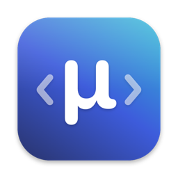
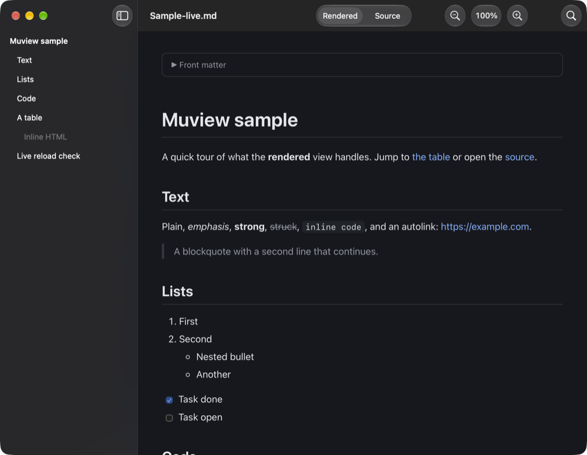

<p align="center"></p>

# Muview

A small, fast, native macOS viewer for markup files. Open a file, read it, and it stays up to date while you edit it elsewhere. Muview never writes to your files.



## What it does

- **Markdown** rendered as GitHub-flavoured Markdown: tables, task lists, strikethrough, autolinks, footnotes, inline HTML, and YAML front matter tucked into a collapsible block.
- **HTML** shown as the page itself, with its own styles, images and scripts.
- **SVG** shown as an image on a checkered background.
- **XML, plist and other text** shown as syntax-coloured source with line numbers.
- **Rendered / Source** toggle (⌘U) for Markdown, HTML and SVG.
- **Outline sidebar** built from the document's headings; click to jump.
- **Live reload** when the file changes on disk, keeping your scroll position.
- Find (⌘F), zoom (⌘+ / ⌘− / ⌘0), reload (⌘R), print or save as PDF (⌘P).
- Links to other markup files open in Muview; web links open in your browser.
- Light and dark appearance.

Code blocks are not syntax-highlighted yet.

## Build

Requires macOS 14 or later, Xcode, and [XcodeGen](https://github.com/yonaskolb/XcodeGen).

```bash
xcodegen generate
```

```bash
xcodebuild -project Muview.xcodeproj -scheme Muview -configuration Release -derivedDataPath build build
```

The app lands in `build/Build/Products/Release/Muview.app`. Copy it to `/Applications` to use it with Finder's **Open With**.

The icon is drawn by a script; to regenerate the master image:

```bash
swift Tools/make-icon.swift app icon.png
```

## Layout

| Path | Purpose |
|------|---------|
| `Muview/MuviewApp.swift` | App entry, read-only document type, menu commands |
| `Muview/ViewerView.swift` | Window UI: outline, toolbar, web view host |
| `Muview/ViewerModel.swift` | Loading, live reload, link handling, zoom, find, print |
| `Muview/Renderer.swift` | Markdown to HTML, source highlighting, page template |
| `Muview/Style.swift` | Stylesheet for rendered and source views |
| `project.yml` | XcodeGen project definition |

Markdown parsing uses [swift-cmark](https://github.com/swiftlang/swift-cmark) (GitHub-flavoured branch, BSD 2-Clause).

## License

Copyright (C) 2026 Raul Silva

Muview is free software: you can redistribute it and/or modify it under the terms of the GNU General Public License as published by the Free Software Foundation, either version 3 of the License, or (at your option) any later version.

Muview is distributed in the hope that it will be useful, but WITHOUT ANY WARRANTY; without even the implied warranty of MERCHANTABILITY or FITNESS FOR A PARTICULAR PURPOSE. See [LICENSE](LICENSE) for the full text.
